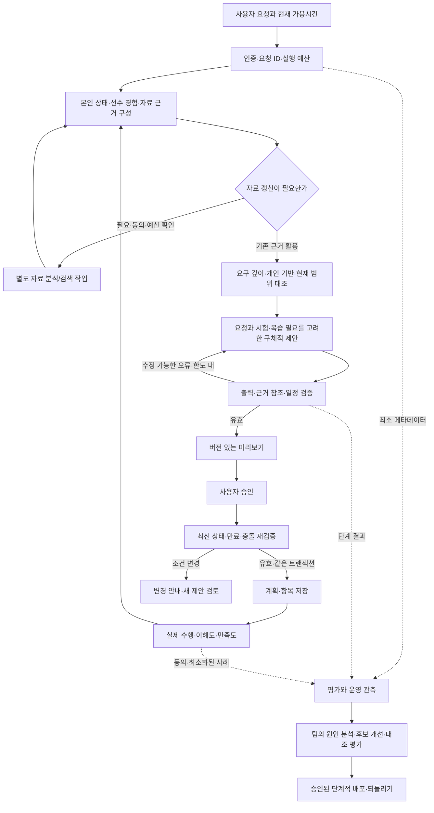
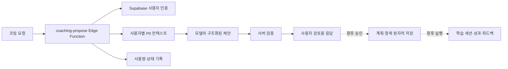

# UniLink 코칭 에이전트 하네스와 지속 개선 구조

최신 정리: 2026-11-11. **하네스는 새 SDK를 붙이는 작업이 아니라, 모델 판단을 서비스의 데이터·권한·검증·승인·실행 결과·평가·배포와 연결하는 실행 구조다.** 기존 단일 오케스트레이터를 강화한다.

이번 구현: 입력 v6/지침 v17, 일회성 요청의 단원 선별, 관련 선수 자기 관측, 추가 시험/과제 조언, 자료 없는 공개 검색, 완료 기준, 21일 전망/14일 실행 분리 및 DB 0032의 안전 승인 코드를 추가했다. Terra 설정은 유지한다. **이번 운영 DB·서버 배포는 미실시**이며 상세 실제 상태와 RAG 발전 순서는 [11월 11일 구현 기록](../coaching-diagnosis-release-2026-11-11.md)을 우선한다. 아래의 차이 표와 계획은 구현 전 검토·설계 이력이며 전부 완료된 기능 목록이 아니다.

## 1. 방향과 완료의 의미

- 제품 목표: 실제 자료와 사용자 상태에 맞는 구체적인 학습 계획을 제공하고 실행 결과로 다음 추천을 개선한다. 유창한 답변이나 승인률만으로 성공을 판단하지 않는다.
- LLM은 내용·수준·선수 개념·활동·범위·잠정 시간을 판단한다. 하네스는 필요한 근거를 제공하고 안전한 실행과 개선 여부의 검증을 맡는다.
- 사용자 소유권·시간 충돌·승인·중복 방지는 강제 경계다. 모든 과목에 고정 학습 순서, 동일 시간 비율, 보편적 난이도 가중치를 강제하지 않는다.
- 선택 입력이 없다고 기다리거나 입력을 강요하지 않는다. 자료와 관측을 바탕으로 잠정 추천하며, 핵심 근거가 불완전하면 그 범위와 가정을 밝힌다.
- 개인화는 본인 DB 기록을 활용한다. 사용자 전체 데이터 학습·모델 파인튜닝·임의의 영구 성향 생성은 현재 범위가 아니다.
- 운영 배포, 기능 검증, 추천 품질, 교육 효과, 비용 적정성, 서비스 유지율은 서로 다른 완료 기준이다.

### 1.1. 학습 진단과 능동적 시험 대비 (2026-11-11 구체화)

코칭은 요청 문장을 일정으로 옮기기만 하는 기능이 아니다. PDF/계획서·실제 문제 자료·출처 있는 검색으로 **필요한 내용과 깊이**를 확인하고, 본인 선수지식/관련 경험·회차별 진도/속도/난이도 평가·이해도·실제 수행으로 **개인 기반과 공백**을 판단한다. 우선순위 수식으로 이 진단을 대체하지 않는다. 과제/강의 예제는 시험 역량을 만드는 과정으로 연결하되 연결 근거와 별도 제출 기준·마감을 보존한다.

사용자의 텍스트는 내용·상황·어려움을 이해하는 중요 입력이다. '이번 요청이 과거 선호보다 우선'한다는 원칙이 다가온 시험/과제·필요한 재확인까지 무시한다는 뜻은 아니다. 'A 위주' 같은 소프트 요청에는 허용된 검토 범위에서 놓친 학습 후보를 제안하되, 명시 제외·가용시간·선택 목표·승인은 우회하지 않는다. 하루는 선택 작업 중심, 주간/시험은 시험 준비·선수 공백·필요 복습을 함께 검토한다. 미선택 과목은 별도 후보 제안/선택 단계를 거쳐야 하며 현재 그 경로가 구현됐다고 가정하지 않는다.

어려움·중요성·마지막 학습/확인 시점·수행/채점의 부족·시험까지 기간으로 복습/짧은 재확인·회독·기출 적용을 판단한다. 검색은 일반적인 내용/깊이를 보완할 뿐 개인 이해도를 증명하지 않으며, 고난도라는 이유만으로 매번 같은 확인 문제를 반복하지 않는다. 관련 기록이 없으면 잠정안을 제안하고 입력을 기다리지 않는다.

현재 자료 선별에는 화면의 자유 요청 constraints가 직접 연결되지 않고, 문제은행은 라벨/단계 중심이며, 검색도 추출 PDF 단원 중심이다. 관련 선수 이력·미선택 후보·자료 없는 검색은 보완 대상이다. 3주 준비 요구는 장기 준비 horizon과 실행 구간의 분리로 설계하되 **현재 API 1~14일/화면 14일 제한**을 조용히 풀거나 잘라 처리하지 않는다.

정확한 현재/미구현 구분, 일회성 텍스트의 비저장 해석 경계, 데이터·평가 사례는 [학습 진단과 능동적 시험 대비 요구사항](../coaching-learning-diagnosis-2026-11-11.md)을 따른다. 이는 H0-A 안전 기반을 대체하지 않으며 R1/R2의 내용 계약을 4번의 완료 기준·H0-B/C 평가와 함께 발전시킨다.

## 2. 현재 있는 하네스와 남은 차이

기준 소스는 main `15d3e1c`다. 2026-11-10 DB 0029/0030과 코칭 함수 v26 배포 및 합성 계정의 실제 API/RPC 검증은 [운영 기록](../coaching-personalization-deployment-2026-11-10.md)을 따른다. 당시 실행·주제 이해도·평가·문제은행 연결 기록이 0건이었던 사실은 그 시점의 조회 결과이지 영구적인 상태가 아니다.

| 단계 | 현재 코드의 근거 | 다음 보강 |
| --- | --- | --- |
| 인증·요청·중복 방지 | `coaching-propose/index.ts`, `coaching/run.ts`, JWT·요청 해시·run 기록 | 전체 실행 예산, 실패 분류, 동일 요청 경쟁·중단 복구 |
| 개인 상태 구성 | `coaching/context.ts`, `input.ts`, `personalization.ts`, `problemBank.ts` | 선택/누락 이유·자료 버전 연결, 수정/삭제 시 파생 결과 무효화 |
| 자료 분석·검색 결과 | `courseKnowledgeStore.ts`, `courseKnowledge.ts`, 별도 `course-knowledge` 함수 | 실제 원본 대조, 단계별 오류·캐시 적중·근거 사용 평가 |
| 계획 생성·검증 | `coaching/model.ts`, `contract.ts` | 완료 기준·출처의 구조화, 내용 품질 평가, 오류별 재시도 |
| 승인·저장 | migration 0017의 `approve_coaching_proposal(p_run_id)`, 원자적 저장·반복 승인 방지 | 만료·최신 일정·동시 승인·수동 수정과의 정합성 검증 |
| 기록·개인화 | `study_sessions`, `topic_observations`, `coaching_satisfaction`, 근거 뷰 | 실제 실행 UI 전체, 계획 범위와 결과 연결, 근거 있는 개인 보정 |
| 평가·운영 | 자동 테스트, `scripts/evaluation/`, run/job·사용량 기록 | 단계 추적, 평가셋·릴리스 기준·부분 배포·복구 절차 |

현재는 서버가 필요한 정보를 정해 조회하고 모델을 호출하는 구조다. 모든 조회가 모델의 Tool Calling으로 구현된 것은 아니다. 필요와 평가 근거가 생길 때만 제한된 읽기 도구를 노출한다. 다중 에이전트·벡터 DB·새 프레임워크로 전면 재작성하지 않는다. 공식 문서도 작은 단일 에이전트부터 시작하고 역할·권한 분리가 필요할 때 확장하는 접근을 설명한다. [OpenAI Agent definitions](https://developers.openai.com/api/docs/guides/agents/define-agents)

## 3. 목표 실행 구조



이 그림은 목표 구조다. 최신 승인 검증, 단계 추적, 실행 UI, 평가 게이트가 모두 이미 구현됐다는 뜻은 아니다.

### 실행 책임

| 경계 | 책임 | 금지 |
| --- | --- | --- |
| 요청/오케스트레이터 | 현재 요청, 목표 ID, 상태 전이, 총 호출/시간/예산 관리 | 무제한 모델/검색 루프, 새로고침마다 중복 생성 |
| 상태·근거 구성 | 사용자/목표별 사실·관측·추정을 출처·시점과 함께 선별 | 타 사용자 혼입, 미입력=실패, 오래된 자료를 최신 사실로 포장 |
| 자료·검색 도구 | 허용된 자료/검색만 제한된 크기로 조회, 버전/상태 반환 | 임의 SQL·임의 URL·범용 쓰기·비밀키를 모델에 제공 |
| 계획 생성 | 근거에 맞춰 내용·수준·범위·시간을 유연하게 제안 | 출처 없는 교재 내용·실제 시험·동료 평균 시간 창작 |
| 검증/승인 | 출력 계약과 참조·시간·권한을 확인, 승인된 버전만 저장 | LLM의 '검증 완료' 문장을 검사로 대체 |
| 실행 관측 | 실제 수행 범위·시간과 자기평가/채점을 분리 | 완료 체크=숙달, 중단 시간=정상 속도 |
| 평가/배포 | 실패 원인을 재현 가능한 사례로 만들고 후보를 비교 | 운영 중 자동 프롬프트 수정·가중치 승격·무승인 배포 |

검사는 실제 쓰기가 일어나는 경계에도 있어야 한다. 상위 프롬프트나 입력/출력 검사만으로 모든 도구 부작용이 보호되지는 않는다는 공식 지침과 일치한다. [OpenAI Guardrails and human review](https://developers.openai.com/api/docs/guides/agents/guardrails-approvals)

## 4. 출시 전에 먼저 보강할 기반 H0

H0는 공부 방법의 고정 규칙이 아니라 데이터·실행·배포 안전 기반이다. 작은 변경으로 나눠 구현하며 대규모 재설계가 끝날 때까지 기존 4~7번을 모두 멈추는 방식은 택하지 않는다.

### H0-A. 승인 시점 정합성: 가장 먼저 구현할 안전 보강

코드 확인 결과 migration 0017의 승인 RPC는 본인 run 잠금·상태·시간대·계획 저장·반복 승인을 처리한다. 그러나 해당 함수 본문에는 `expires_at` 확인이나 최신 차단 일정·가용시간을 읽어 다시 검증하는 처리가 없다. run 하나를 잠그는 것만으로 서로 다른 제안의 동시 승인까지 직렬화되지는 않는다. 이미 실제 사고가 있었다는 뜻은 아니지만 공개 사용 확대 전에 막아야 할 경계다.

1. 생성 시의 **구조화된 실행 계약**을 별도 허용 필드로 저장한다. 목표/기간, 확인된 시간창·분량·휴식 규칙, 시간대, 자료/계획 상태 버전, 만료와 검증 버전을 포함한다. 일회성 자유문장은 다시 저장하지 않는다.
2. 현재 `coachingRequestPayload`와 0030 트리거는 요청에서 목표·종류·기간 중심으로만 보존한다. 따라서 원래 시간창/규칙을 과거 payload에서 복원할 수 있다고 가정하지 않는다. 새 계약 위치·RLS·최소 필드 정책을 함께 설계한다.
3. 사용자 승인 시 최신 목표/토픽·방법·자료 상태·일정·가용성·만료를 다시 확인한다. 변경되면 이유와 영향 항목을 보여주고 새 제안을 검토하게 한다. 같은 승인에 새 모델 결과를 몰래 교체하지 않는다.
4. 사용자별 일정 변경의 직렬화 또는 동등한 동시성 계약을 같은 저장 트랜잭션에 둔다. 수동 일정 수정·다른 승인 경로도 같은 규약에 참여해야 한다. 승인 RPC만 잠그고 다른 쓰기가 우회하면 보장이 성립하지 않는다.
5. 단순 최대 `updated_at`만으로 삭제/동시 변경을 모두 잡는다고 가정하지 않는다. I/U/D를 반영하는 revision 또는 재조회/잠금 설계와 충돌 테스트로 확인한다.
6. 기존 v2 제안은 읽기 호환성을 유지한다. 새 계약이 없는 이전 제안은 검증 가능 범위를 표시하고 재생성/새 검토로 전환하는 이행 정책을 정한다. 누락 계약을 추정해서 채우지 않는다.

완료 확인: 생성 후 일정 추가/삭제, 목표 변경, 만료, 두 제안 동시 승인, 수동 수정과 승인 경합, 반복 승인, 이전 제안 호환 테스트. 권한·중복·충돌 회귀 사례를 통과해야 한다. 이번 문서 변경에서는 RPC나 DB를 수정하지 않았다.

### H0-B. 최소 실행 추적과 오류 복구

기존 run/job·usage를 재사용해 단계별 `trace_id/run_id`, 단계 이름, 시작/종료, 허용 오류 코드, 재시도 횟수, 선택 근거 수, 자료/도구 버전, 사용량의 확인 여부를 연결한다. 모델의 숨은 추론·원문 PDF·인증 토큰·일회성 문장을 자동 로그로 남기지 않는다. 외부 tracing 서비스를 붙일 때도 원문 자동 수집을 기본으로 켜지 않는다.

- UI 닫기/네트워크 재전송/서버 종료/제공자 시간 초과를 구분한다. 중단된 `generating` 상태의 회복·실행 소유권·중복 방지를 시험한다.
- 현재 최대 2회 생성 시도와 개별 요청 시간 제한은 존재한다. 로더·분석·대기를 포함하는 전체 예산과 오류 종류별 재시도 계약은 추가 설계 대상이다.
- 권한/소유권/동의 오류는 모델 재시도로 고치지 않는다. 일시적 오류만 제한적으로 재시도한다. 기존 사용자 데이터로 '성공'을 꾸미지 않는다.
- 제공자 실패·파싱 실패의 사용량이 확인되지 않으면 미확인으로 표시한다. 부분 성공 usage만 합쳐 전체 비용이 확정됐다고 설명하지 않는다.
- 장시간 자료 분석은 기존 분석 작업과 캐시를 재사용한다. 필요가 확인되면 작업 상태 조회·재개/취소와 lease를 보강하고, 모든 상호작용을 긴 동기 요청 하나로 합치지 않는다.

### H0-C. 평가·릴리스 계약

대표 평가셋과 최소 추적을 4번 개발과 함께 준비한다. 프롬프트를 바꾸고 느낌으로 운영에 바로 올리는 방식에서 벗어나야 한다. 실행 과정 평가와 반복 가능한 데이터셋 비교를 구분하는 공식 지침을 참고한다. [OpenAI Agent evals](https://developers.openai.com/api/docs/guides/agent-evals)

- 무료 CI: 기존 자동 시험 + 승인 경합/만료 + 단계별 근거 전달 + 개인정보/도구 권한 + 예산/재시도 + 이전 버전 호환.
- 내용 평가셋: SQL/실습·이론·자격증/개인 학습, 낮음/높음/미입력 이해도, 오래되거나 상충하는 관측, 자료 없음/계획서만 있음/파일 갱신, 촉박한 마감, 실제 불가능한 시간창, 일회성 요청 비재사용.
- 학습 진단 대조: 같은 요구 수준에서 선수 기반만 변경, 수업 속도와 개인 이해도 구분, 문제은행 본문 부재, 자료 없는 검색, 자유 요청의 자료 선택 반영, A 위주/B 제외와 B 시험 임박, 하루와 주간 범위 구분, 최근 확인 유무에 따른 복습 차이, 과제의 시험 역량 연결 및 21일 요청 처리. 검증 계약은 2026-11-11 요구사항의 사례표를 따른다.
- 같은 모델·같은 사실을 고정하고 변경 축을 분리해 여러 번 비교한다. 스키마 통과와 일정 준수만으로 수준 적합성을 입증하지 않는다.
- 내용 점검: 범위/출처 정확성, 진도·이해도 적합성, 구체적 과업/완료 기준, 실행 가능성, 사용자 수정 부담. 생성 예시와 실제 교재 사실을 구분한다.
- LLM 채점은 보조로만 사용한다. 사람 검토·결정적 검사·실제 사용 결과를 분리하고 평가에 쓴 사례를 최종 검증 전체로 재활용하지 않는다.
- 운영 실패는 오류 유형·최소 근거로 재현 사례화한다. 원문 비저장 정책을 깨고 실제 일회성 문장을 평가셋/Git에 복제하지 않는다. 합성 재구성이나 별도 동의·비식별 검토를 사용한다.
- 유료 대조는 별도 승인한 호출/예산 범위에서만 실행한다. 자동 배포마다 유료 전체 평가를 돌리지 않는다.

## 5. 결과가 개선되는 두 개의 순환

### 개인 추천 순환

`계획 항목과 완료 기준 → 실제 시간/수행 범위/부분 완료 → 이해도·채점·평가 관측 → 관련 근거 조회 → 다음 추천 → 사용자 검토`

예: '오늘만 20분'은 이번 요청이다. 같은 종류·수준·범위의 활동에서 계획 대비 실제 수행이 반복해서 다르면 그 근거로 다음 배정을 잠정 조정한다. 느린 속도라는 영구 라벨이나 한번 설정한 고정 배율로 바꾸지 않는다.

만족도는 계획 전체에 대한 의견이고 학습 효과가 아니다. 실행 여부, 자기 이해도, 확인 문제 결과는 별도 기록/척도로 유지한다. 표본 수·최근성·활동 비교 가능성·중단/부분 완료·상충 기록을 함께 보여준다. 초기/복귀 사용자도 기록이 적다는 이유로 추천을 막지 않는다.

파생 요약·보정 캐시를 추가한다면 원천 관측 ID, 생성 규칙/버전, 적용 범위, 유효 시점·취소 경로를 둔다. 원천 수정/삭제·자료 버전 변경 시 새 추천에 오래된 요약을 쓰지 않도록 무효화한다. 현재 입력 스냅샷 보존과 향후 조회 제외의 차이는 기존 개인정보 안내대로 유지한다.

### 서비스 개선 순환

`실패/불만 유형 수집 → 원인 구분 → 재현 사례 → 입력/도구/프롬프트/검증의 후보 수정 → 대조 평가 → 팀 승인 → 소규모 배포 → 관측 → 유지 또는 되돌리기`

근거 누락은 입력 선택을, 자료 오독은 추출/원본 확인을, 지시 혼동은 프롬프트/도구 계약을, 시간 충돌은 저장 경계를, 과도한 비용은 근거 크기·캐시·호출 정책을 고친다. 모든 문제를 더 비싼 모델·더 긴 프롬프트·더 많은 PDF 토큰으로 해결하지 않는다.

서비스 개선은 팀의 검토를 거치는 버전 변경이다. 사용자 요청마다 AI가 스스로 운영 프롬프트나 서버 규칙을 수정하는 자동 학습 구조가 아니다.

## 6. DB와 버전: 기존 기반 우선

| 요구 | 기존 기반 재사용 | 추가 설계 후보와 경계 |
| --- | --- | --- |
| 실행 식별/결정 | `coaching_runs`, `coaching_proposal_jobs` | 실행 계약·단계 추적. quota 원장을 장기 학습 기록으로 대체하지 않음 |
| 버전 | model/prompt/policy/contract, snapshot의 입력 v5, usage의 가격표 버전 | 코드 commit·배포·근거/도구 버전의 manifest. 제공자 alias가 고정 버전임을 가정하지 않음 |
| 학습 상태 | `topic_observations`, `topic_learning_states`, `topic_check_states`, 문제은행 view | 단일 숙달 점수로 합치지 않음. 'Learner State' 이름의 중복 전체 복사 테이블은 우선 만들지 않음 |
| 수행/평가 | `study_sessions`, `coaching_feedback`, `coaching_satisfaction` | 5번에서 수행 범위/사유·정정 연결을 보완. 만족도 현재 평가와 불변 원천 사건의 차이를 명시 |
| 기준/재계획 | `study_plan_items.completion_criteria`, plan의 parent/revision | 4번 완료 기준 JSON 계약, 6번 수정 diff/승인. 계획/실제 시간 별도 |
| 자료/캐시 | `course_knowledge_tasks`, 노트와 분석 버전/근거 | 사용자·목표·파일 버전·모델/분석 버전·동의 범위의 캐시 키 및 무효화 |
| 평가/운영 추적 | 기존 `scripts/evaluation/`, 평가 결과 파일 | 먼저 합성 평가 파일/최소 로그. 단계 이벤트·평가 저장이 필요할 때만 새 테이블 검토 |

새 테이블/필드는 설계 후보이며 이미 생성된 것으로 표현하지 않는다. DB 변경 시 새 migration, 소유권 RLS·최소 권한·사용자 포함 FK·인덱스·중복 방지·정정/삭제·보관 정책을 함께 검증한다. 기존 0030의 일회성 원문 비저장 정책을 우회해서 전체 요청을 trace 테이블에 복사하지 않는다.

현 snapshot은 최소화된 학습 근거이지 원래 요청 전체가 아니다. 재현에는 버전·허용된 구조화 계약과 합성 사례를 사용하며 일회성 문장의 완전 재생 가능성을 약속하지 않는다.

## 7. 배포·운영을 지탱하는 출시 기준

현재 `.github/workflows/deploy.yml`은 main과 dev 모두 같은 GitHub Pages 배포 경로를 사용하며 Supabase DB/함수는 별도다. 운영/검증 환경 분리와 배포 manifest가 필요한 이유다. 이미 분리된 staging이 있다고 가정하지 않는다.

| 출시 전 확인 | 필요한 동작 | 통과 확인 |
| --- | --- | --- |
| 환경/접근 | staging·production의 DB/API 프로젝트·키·예산·권한 분리 | dev 변경이 운영 웹/DB를 덮지 않음, 팀 역할과 비상 접근 확인 |
| 배포 정합성 | commit·웹·DB·함수·입출력·프롬프트/정책 버전 기록 | 적용 전 호환성 시험, 적용 후 실제 인증 API smoke |
| DB 이행/복구 | 가산적 migration, 옛 데이터 읽기, 복구본과 복호화/복원 시험 | 실패 복구 절차·담당자·보관 종료 확인. DB reset/파괴적 down migration을 기본 복구로 사용하지 않음 |
| 예산/신뢰성 | 사용자/전체 quota, 동시 실행 한도, 전체 deadline, 단계별 호출/비용 한도 | 시간 초과·재시도 폭증·키 만료·부분 실패를 시험하고 안내 |
| 개인정보/권한 | 원문 비저장, 자료 동의·철회, 파일 접근, owner-scoped 캐시/trace | 타 사용자 접근·악성 PDF/검색 문장·삭제 후 재사용 차단 사례 통과 |
| 장애 대응 | run ID로 단계 확인, 기능 중단 스위치, 지원/알림과 비상 배포 | 잘못된 계획의 자동 저장 방지, 마지막 정상 코드/설정으로 되돌리기 |
| 유료 기능 의존 | OAuth 검증/테스트 사용자·할당량·공유 키/외부 서비스 상태 | Drive 연동 가능 범위와 대체 업로드 경로를 실제 계정에서 확인 |

OpenAI 공식 운영 지침의 환경 분리·키 관리·사용량 관리 원칙을 참고하되, UniLink의 Supabase·웹·교육 데이터 경계에 맞춰 적용한다. 이 표는 비용이 드는 새 인프라를 이번에 생성했다는 뜻이 아니다. [OpenAI Production best practices](https://developers.openai.com/api/docs/guides/production-best-practices)

## 8. 실행 순서와 작은 배포 단위

| 순서 | 작업 | 최소 산출물/완료 기준 |
| --- | --- | --- |
| H0-A 선행 | 승인 시점 정합성·만료·동시성 + 구조화 실행 계약 | 기존 승인 호환·시간창 보존·수동/동시 변경 시험. 범용 출시 확대 전 확인 |
| H0-B/C 최소판, 4번과 병행 | 단계 오류/버전 추적·대표 평가셋·릴리스 체크리스트 | 원문 없는 한 run의 실패 원인 확인, 무료 회귀와 후보 비교 기준 |
| R1/R2, 4번과 병행 | 요구 깊이/개인 선수 기반 진단·텍스트 해석·후보 검토 계약 | 기존 관련 근거 재사용, 시험/복습 누락 제안과 명시 제외 준수, 선택 외 일정의 무단 편입 금지. 자료 없는 검색/은행 내용 경로는 동의·비용 경계와 함께 단계 구현 |
| 기존 4번, 다음 기능 | 작업 범위·완료 기준·출처를 출력/저장/화면에 연결 | 스키마→검증→승인→DB→화면, 과거 v2 읽기 |
| 기존 5번 | 실제 수행/부분 완료/사유/이해도 정정 UI 연결 | plan item ID와 관측 연결, 재전송 중복 방지, 다음 추천 반영 |
| 기존 6번 | 결과 기반 재계획·변경 미리보기·승인 | 원래 계획과 완료/수정 항목 보존, 최신 정합성 재검증 |
| 6번 관련 후속 | 3주 시험/자격증 준비 horizon과 실행 window 분리 | 현 14일 계약·UI·승인·관측과의 호환 검증 후 지원. 단순 21일 상한 변경/여러 결과 이어붙이기로 대체하지 않음 |
| 기존 7번 | 비교 가능한 본인 기록의 시간/분량 보정 | 근거 수·범위·시점·불확실성·중단 가능성·오차 대조 |
| 공개 확대 전 운영 게이트 | staging, 배포/복구, 예산/권한/장애 대응, 파일 동의 | 체크리스트와 담당자 승인, 실제 계정 pilot 결과 |
| 필요가 입증된 뒤 | 선택적 읽기 Tool Calling·모델 라우팅·다중 에이전트 | 기존 단일 흐름 대비 품질/비용/지연 이득을 시험으로 확인 |

H0 추가는 학습 기능 전체 순서를 갈아엎는 변경이 아니다. 저장 경계의 확인된 공백 때문에 H0-A를 선행하고 4~7번을 계속 연결한다. 일정·예산·지원 인력이 정해지기 전 임의의 출시일이나 성공률을 약속하지 않는다. 실제 작업 순서의 원장은 [coaching-priorities.md](../coaching-priorities.md)다.

## 9. 서비스 지표와 지속 개선 운영

- 기술 품질: 유효 제안 비율, 오류 종류, 중복/충돌·권한 사고, p50/p95 전체 응답시간, 재시도율, 자료 캐시 적중, 유효 추천당 토큰·추정 비용/미확인 비용.
- 사용성: 제안 검토→승인→실제 시작→수행 기록→다음 계획 재사용. 승인·만족도·다음 주 재사용을 따로 본다.
- 학습 적합성: 자료 범위·진도·이해도에 맞는 활동과 완료 기준, 사용자 수정 부담, 별도 채점/이해도 변화. 완료율만으로 교육 효과를 주장하지 않는다.
- pilot 시작 전에 팀이 latency·예산·품질의 목표/중단 조건을 정한다. 작은 표본의 개선을 통계적 일반화나 서비스 성공으로 포장하지 않는다.
- 개인정보/소유권/중복 적용 같은 중대 회귀 사례는 0건 통과가 배포 조건이다. 일반 학습 과업의 분량/시간 가이드는 이 안전 기준과 다르다.
- 실패 유형 검토→작은 수정→대조→릴리스→관측을 반복한다. SLO/경보·운영 점검은 구현/담당자가 있어야 하며 이 문서만으로 자동 실행되지 않는다.
- 평가 로그·지원 문의·백업·개인화 원천의 보관 기간과 삭제 담당자를 각각 정한다. 사용 기록을 수집한다는 이유로 노트 원문을 범용 분석 도구에 전송하지 않는다.

## 10. 이번 정리의 범위

현행 코드/스키마와 11월 10일 운영 기록, OpenAI 공식 문서를 대조해 구조와 후속 계획을 갱신했다. 이번에는 문서만 수정했다. 새 기능 구현·프레임워크 설치·DB 변경·운영 배포·유료 평가·커밋/푸시는 수행하지 않았다. README/ERD 등 사용자 측의 다른 변경은 되돌리지 않는다.

2026-11-11에는 사용자 설명에 따라 '필요 깊이와 선수 기반 진단 → 요청과 시험/복습 필요의 조정 → 모드별 범위 → 반복 확인'의 요구와 현행 코드 차이를 추가했다. 현행 입력 v5/지침 v16이 그 요구를 모두 수행한다고 해석하지 않는다.

다음 구현의 첫 단위는 H0-A의 실행 계약과 승인 경계 시험이며, 다음 사용자 기능은 기존 4번 완료 기준 구조화다. 아래는 10월 검토 당시 원문을 보존한 이력으로 현재 구현/현재 계약보다 우선하지 않는다.

---

## 부록: 2026-10-01 하네스·Planner Policy 검토 이력

**이하의 '미구현/현재/향후'와 API·버전 설명은 작성 당시 기록이다. 현재 구현 판단에는 위 1~10절과 최신 운영 기록을 사용한다. 고정 학습 시간·가중치 제안도 확정 규칙이 아니다.**

### UniLink 코칭 에이전트 하네스와 Planner Policy

이 문서는 현재 구현과 `UniLink_Planner_Policy_제약사항_검토안_v1_재정리.docx`의 정책 초안을 통합한다. **정책에 적힌 항목이 곧 구현 완료를 뜻하지 않는다.** 현재 하네스는 확인된 시간 창 안에서 계획 *제안*을 반환하며, 저장·승인·실행·성과 보정은 연결되지 않았다. 정책 수치와 우선순위는 팀 검토안이다.

#### 2026-10-01 구조 검토 결론

현재 코드는 **단일 모델 호출형 제안 하네스**로서 적절한 시작점이다. 완성된 적응형 학습 에이전트는 아니다. 하네스의 역할은 인증, 컨텍스트 구성, 도구 권한, 출력 검증, 승인, 저장, 관측을 관리하는 것이며 공부 순서를 고정 알고리즘으로 대신 결정하는 것이 아니다.

아래 기존 H/S/R/T 표는 검토 이력이다. 향후 구현에서는 다음 구분을 우선한다.

- **불변 실행 경계:** 사용자 소유권, 유효한 참조, 데이터 격리, 승인 없는 쓰기 금지, 중복 적용 방지, 확정 일정 충돌 방지. 서버가 강제한다.
- **사용자 확정 제약:** 이번 요청에서 확인한 가용 시간, 종료 시각, 필수 휴식. 서버가 지키며 충족 불가 시 재질문한다. 모델이 임의로 완화하지 않는다.
- **학습 가이드:** 방법별 권장 분량, 하루 집중 목표 수, 긴급도와 장기 커버리지의 절충. 기본적으로 소프트 선호이며 예외 이유와 사용자 수정을 허용한다. 사용자가 명시적으로 고정한 경우만 해당 요청의 하드 제약으로 승격한다.
- **운영 한도:** 요청 기간, 항목 수, 호출 횟수, 토큰과 시간 한도. 교육적으로 최적이라는 의미가 아니라 비용·응답 크기 경계다.

기존 H3/H5의 최소 시간, H6의 집중 목표 수를 모든 학습자에게 보편적인 하드 규칙으로 취급하지 않는다. H7의 근거 없는 추정 금지는 유지하되 프롬프트만으로 사실성이 보장되지는 않으므로 출처와 확인 상태를 출력 계약에 추가한다. 고정 가중치로 목표 순위를 먼저 확정하고 LLM이 문장만 작성하는 구조는 채택하지 않는다.

연속 학습 상한의 누적 검사, 하루별 집중 목표 제한, 0분인 날의 빈 시간 창은 이번에 수정했다. 빈 계획/재질문 응답, 승인 저장, 정규 DB 행의 화면 조회는 다음 구축 단계다. 아래의 '검증' 표현은 현재 코드가 수행하는 검사이며 완전한 보장을 뜻하지 않는다.

목표 흐름은 `인증 → 관련 사실 조회 → 부족하면 질문 → 모델 제안 → 서버 검증 → 제한된 수정 시도 → 사용자 검토 → 최신 상태 재검증 및 원자적 승인 → 실행 기록 → 다음 요청에 피드백 반영`이다. 초기에는 단일 오케스트레이터로 충분하며 다중 에이전트, 무제한 도구 루프, 벡터 DB는 필수 조건이 아니다.

#### 현재 흐름



- `POST /functions/v1/coaching-propose`는 로그인한 사용자의 Supabase JWT를 요구한다. 요청은 본인 소유의 활성 목표 `goal_ids` 1~5개, `intent` (`weekly_plan`, `daily_plan`, `exam_prep`, `topic_review`, `progress_check`), 최대 14일의 날짜 범위, 날짜마다 확인된 `day_budgets` (`date`, 0~480 `minutes`, 학습하는 날 1~8개, 0분인 날 0~8개의 `windows`), `desired_outcome`, `constraints`, `rules`를 받는다. `rules`에는 전환·휴식 분, 연속 학습 허용 분, 방법별 최소 분, 하루 집중 목표 수, 이월 여부를 설정한다. 적어도 하루는 15분 이상이어야 한다. 빈 캘린더를 종일 가용 시간으로 간주하지 않는다.
- 컨텍스트 로더는 확인된 사용자 ID로 활성 `learning_goals`, 확정된 `goal_topics`, 활성 `study_methods`, 차단 `calendar_events`, 활성 과목의 `course_schedules`, 차단 `recurring_commitments`, 기존 예약 `study_plan_items`, 최근 `study_sessions` 100건, 사용자 시간대를 읽는다. 크기 제한을 넘으면 조용히 누락하지 않고 실패한다. 이전 데이터의 추정 완료 시각·계획 시간은 확정 사실로 취급하지 않는다.
- 모델에는 제한된 필드만 전달한다. 노트 본문, Drive 파일 내용, 문제은행 업로드, OAuth 자격 증명, 원본 메타데이터, 다른 사용자 행은 보내지 않는다. 사용자 입력과 DB 제목은 명령이 아니라 데이터로 취급한다.
- 현재 응답은 `schema_version: 2`와 `summary`, 최대 30개의 `items` (`goal_id`, `topic_id`, `method_code`, `title`, `planned_date`, 현지 시각 `start_time`, `planned_minutes`, `reason`) 및 `deferred_goals` (`goal_id`, `reason`, `reconsider_on`)다. 서버는 ID·소유권·확정 토픽·활성 방법·날짜별 합계 예산·시간 창·고정 일정 충돌·전환/휴식 여유·방법별 최소 분·집중 목표 수·이월 설명을 검증한다. 부적합한 출력은 저장하지 않고 실패한다.
- 항목의 `start_time`은 사용자 시간대의 현지 시각이다. 분 단위 시간 창 안에서만 계획하며, `day_budgets.minutes`는 그날 추가로 사용할 수 있는 학습 총량이다. 수업·약속·이동·휴식을 고려한 시간 창과 여유를 사용자가 확인해야 한다. 실제 이동 경로와 이동 시간은 자동 계산하지 않는다.
- 제안은 `study_plans`, `study_plan_items`, `study_sessions`에 기록되지 않는다. 코칭 화면은 DB 목표와 `coaching-propose`를 호출하며 결과를 미리보기로 보여준다. 모델 호출은 `COACHING_HARNESS_ENABLED=true`와 `OPENAI_API_KEY`가 설정되기 전까지 비활성이다.

#### 정책 수준과 제약

| 수준 | 의미 | 적용 원칙 |
| --- | --- | --- |
| H | 실행 불가능한 계획을 막는 하드 제약 | 필요한 사실·입력 계약이 갖춰지면 서버에서 재검증 |
| S | 후보 사이에서 절충하는 소프트 목표 | 모델의 선택 근거와 평가 지표로 확인 |
| R | 관측 후 고정할 규칙 후보 | 1~2주 수정·실행 데이터로 승격 여부 결정 |
| T | 팀 합의가 필요한 기준 | 확정 전 DB `CHECK`나 불변 상수로 굳히지 않음 |

| 항목 | 목표 동작 | 현재 상태 및 필요한 작업 |
| --- | --- | --- |
| H1 실제 가용 시간·버퍼 | 학습 블록과 필수 여유가 확인된 시간 창을 넘지 않음 | 시간 창·일별 분량·전환 여유 검증. 창 자체가 실제 가용성이라는 점은 사용자 확인 필요 |
| H2 고정 일정 충돌 | 수업·시험·약속·근로 시간과 중복되지 않음 | 차단 일정, 활성 수업, 반복 약속, 기존 예약 학습 항목과 충돌 검증. 누락된 외부 일정은 알 수 없음 |
| H3 지나치게 짧은 블록 방지 | 의미 없는 쪼개기를 피함 | 항목당 15~180분 및 요청의 방법별 최소값 검증 |
| H4 명시적 선택·이월 | 후보가 많으면 일부를 선택하고 나머지와 이유를 이월 | `deferred_goals`로 미선택 목표의 이유·재검토 날짜 검증. 토픽별 이월은 미구현 |
| H5 방법-시간 적합성 | 실습·과제·프로젝트에 충분한 연속 시간 확보 | 요청의 방법별 최소 연속 분량 검증. 방법별 기본 정책은 미확정 |
| H6 과도한 전환 제한 | 짧은 시간에 과목·방법을 자주 바꾸지 않음 | 목표 전환 시 최소 여유와 하루 최대 집중 목표 수 검증. 전환 횟수 상한은 미구현 |
| H7 근거 없는 상태 추정 금지 | 숙련도·남은 작업량을 지어내지 않고 불확실성 표시 | 현재 모델 지시에서 허구 정보 금지. 파생 지표·신뢰도 계약 미구현 |
| H8 종료·휴식·이동·선호 존중 | 종료 시각, 휴식·이동, 선호 세션 길이 반영 | 창 종료·연속 학습 후 휴식·일정 주변 전환 여유 검증. 실제 이동 경로·시간은 미구현 |

서버 검증은 DB에 기록된 일정과 사용자가 확인한 시간 창에 한정된다. 외부 일정이나 실제 이동 시간을 자동으로 추정하지 않는다. 정책 프롬프트의 지시는 서버 검증을 대신하지 않는다.

#### 선택·집중과 장기 커버리지

모든 목표에 시간을 균등하게 나누기보다 오늘 집중할 목표를 고른다(S). 긴급도/D-day, 중요도, 숙련도 격차, 진도, 복습 지연·첫 노출, 남은 작업량, 실제 가용성, 방법 적합성, 전환 비용, 최근 부하, 사용자 선호를 함께 고려한다. 오래 방치된 목표와 반복 이월을 다음 계획에서 재검토하고, 한 목표에 계속 쏠리는지도 살핀다. 확인되지 않은 값을 임의 점수로 채우지 않는다.

1. 후보의 소유권, 마감, 일정, 가용 시간, 정보 신뢰도를 확인한다.
2. 시간과 방법에 맞는 집중 항목을 선택한다. 의미 없는 짧은 블록과 잦은 전환을 피한다.
3. 선택하지 않은 후보에 `defer_reason`과 다음 검토 힌트를 남긴다. 장기 커버리지 손실을 점검한다.
4. 승인 직전에 서버가 최신 소유권·가용 시간·충돌·방법 제약을 재검증한다. 사용자 수정과 실제 실행을 평가에 반영한다.

정책 문서의 예시에서 과목 5개와 180분이 있어도 각 과목에 30~40분을 배분하는 대신 최적화 60분, 품질공학 60분, 오래 미룬 ML 복습 30분, SQLD 첫 노출 30분을 선택하고 나머지는 이유와 함께 이월한다. 이는 **설명용 예시**이지 확정 가중치나 항상 적용할 일정이 아니다.

##### 방법별 최소 시간 가설 (T/R)

| 방법 | 검토안 |
| --- | --- |
| 개념 복습 (`concept_review`) | 30분 |
| 노트 복습 (`note_review`) | 20~30분 |
| 기본 문제 (`basic_practice`) | 45분 |
| 심화 문제 (`advanced_practice`) | 60분 |
| 오답 복습 (`wrong_answer_review`) | 30분 |
| 간격 복습 (`spaced_review`) | 20~30분 |
| 모의고사 (`mock_test`) | 실제 시험 단위 |
| 과제 (`assignment_work`) | 60분 |
| 프로젝트 (`project_work`) | 60~90분 |

이 수치는 사용자·과목·상황에 따라 조정할 **가설**이다. 현재 구현된 15~180분 검증과 혼동하지 않는다. 실제 `study_methods` 등록값과의 매핑을 확인하기 전에는 고정 enum이나 DB 제약으로 확정하지 않는다.

#### 데이터 책임과 제안 출력

| 구분 | 데이터·처리 | 원칙 |
| --- | --- | --- |
| 입력 사실 | P0 목표·토픽·일정·확인된 가용 시간·학습 기록·선호 | 사용자 소유 행과 명시 입력을 구분 |
| 파생 특성 | D-day, 숙련도 격차, 진도, 복습 부채, 첫 노출, 잔여량, 최근 부하 | 사실에서만 계산. 근거 부족 시 `null`/불확실로 두고 출처·버전 추적 |
| 에이전트 결정 | 선택·이월, 방법, 계획 시간, 우선순위, 이유 | 승인 전에는 제안이며 측정 성과가 아님 |
| 실행·성과·평가 | 실제 `study_sessions`, 향후 결과·피드백·평가 지표 | 계획치와 실제치를 분리하여 보정 |

`0016_coaching_runs_feedback.sql`은 영속 제안 이력과 사용자 피드백 이벤트를 위한 `coaching_runs`, `coaching_feedback`을 추가한다. `coaching-propose`는 생성 전 run을 만들고 검증된 결과 또는 제한된 오류 상태를 기록하며, 같은 요청 키와 같은 본문의 성공 요청은 저장된 결과를 반환한다. 피드백과 계획 승인은 아직 연결하지 않는다. `learner_state_snapshots`, `learning_outcomes` 등은 향후 저장·평가 후보이다. 문제은행·Drive 자료를 사용하려면 별도 접근 권한, 추출·버전·출처·신뢰도·개인정보 필터 설계가 필요하다. 지금은 자료 내용을 모델에 전달하지 않는다.

현재 출력은 `summary`, 시각이 지정된 `items`, 목표별 `deferred_goals`다. 다음 버전에서는 토픽별 이월과 더 자세한 평가 근거를 추가할 수 있다.

```text
items[]: goal_id, topic_id, method_code, planned_date, start_time,
         planned_minutes, reason
deferred_goals[]: goal_id, reason, reconsider_on
summary: string
```

현재 프롬프트는 시간 창·충돌·휴식·방법별 최소값·이월 이유를 지시하고 서버가 결과를 별도로 검증한다. `COACHING_POLICY_VERSION=time-window-v3`, `COACHING_PROMPT_VERSION=scheduled-proposal-v3`는 **Planner Policy v0.1의 모든 정량 규칙이 확정됐다는 뜻이 아니다**. 향후 `coaching_runs.output_payload` 같은 결정을 기록할 때 정책·입력·파생 특성 버전을 연결하되 민감한 원문을 불필요하게 복제하지 않는다.

#### 검증과 팀 합의

회귀 시나리오는 실행 가능성(시간·충돌·휴식·이동·방법), 집중(짧은 블록·전환), 긴급도·중요도, 장기 커버리지·첫 노출, 선택·이월 설명, 불확실성, 사용자 수정·실행에 대한 적응을 측정한다. 다른 사용자 ID, 미확정 토픽, 오래된 가용 시간, 모델의 예산 초과 출력도 거절해야 한다. 1~2주 제안·수정·실행 데이터를 모아 반복적으로 유효한 정량 규칙만 서버 검증으로 승격한다. 프롬프트가 지시하는 범위와 코드가 보장하는 범위를 평가에서 분리한다.

팀에서 정할 사항은 방법별 최소 시간·예외, 전환 횟수 상한, 복습 지연 일수, 첫 노출 기한, 반복 이월 우선순위 상승, 긴급도 대 커버리지 우선순위, 남은 작업량 추정, 낮은 신뢰도에서 재질문할 기준, UI에 보여줄 이월 정보, 규칙 승격에 필요한 지표·표본 규모다. 확정 전 기본값이나 `jsonb` 데이터를 이미 합의된 정책으로 해석하지 않는다.

#### 운영과 다음 구현 순서

2026-11-06 운영 최종 코칭은 **GPT-6.1 Sol**로 분리했다. `COACHING_SYNTHESIS_MODEL` 환경변수 > 서버 전용 DB `coaching_service_settings.synthesis_model` > 기존 `COACHING_MODEL` 순서로 선택한다. 운영 DB 값은 `gpt-6.1-sol`이며, PDF 분석은 `gpt-5.4-mini`, 검색은 `gpt-4.1`로 유지한다. Responses API와 기존 출력·승인 계약을 유지하고 합성 PDF의 실제 호출까지 확인했다. 모델 연결 검증은 실제 강의 추천의 교육적 품질 입증과 다르다. 상세 결과는 `docs/coaching-release-2026-11-06.md`를 참조한다.

마이그레이션 `0014_coaching_proposal_jobs.sql`은 서비스 전용 예약 원장과 원자적 RPC를 제공한다. 사용자별 이동 24시간 5회, 전체 100회, 사용자당 동시 1회, 전체 동시 10회, 2분 리스, 7일 보존이 현재 제한이다. 상태·항목 수·지연 시간·모델/프롬프트/정책 버전만 기록하며 프롬프트·제안·사용자 원문은 저장하지 않는다. 모델 호출까지 간 요청은 실패해도 할당량에 포함된다.

1. 연결된 Supabase 프로젝트에 마이그레이션 0014 적용 여부를 확인한다. `OPENAI_API_KEY`, `COACHING_MODEL`, `COACHING_HARNESS_ENABLED=true`는 호출을 허용할 준비가 됐을 때 Edge Function 비밀값으로 설정한다. JWT 검증을 켜고 `coaching-propose`를 배포한다. 키를 `NEXT_PUBLIC_*`나 GitHub Pages 빌드에 넣지 않는다. `schema_version: 2`를 사용하는 코칭 화면 배포와 함수 배포를 함께 확인한다.
2. 현재 시간 창·충돌·이월 규칙을 실제 사용자 사례로 평가한다. 이동 시간의 출처, 토픽별 이월, 선호와 정보 신뢰도를 추가하고 확정된 방법별 기준만 기본값으로 승격한다.
3. 사용자 검토·수정·승인 UI와 승인 RPC를 연결한다. 승인 RPC는 멱등 키로 AI `study_plans`와 항목을 원자적으로 만들고 최신 소유권·가용성·정책 제약을 재검증하며 개정 이력을 보존한다.
4. `study_sessions`와 결과·피드백을 연결해 정책 버전별 실행 가능성과 성과를 평가한다. 생성 목표치를 실제 성과로 간주하지 않는다. 관측 후 안정적인 규칙만 승격한다.

관련 구현은 `supabase/functions/coaching-propose/index.ts`, `supabase/functions/_shared/coaching/`, `supabase/migrations/0014_coaching_proposal_jobs.sql`이다. DB 경계는 [P0 데이터베이스 설계](p0-database.md)를 함께 참조한다.

#### 하네스 구축 준비안 (2026-10-01 검토)

현재 구조는 단일 모델 호출 후 제안을 검증하는 최소 하네스다. v3 로드맵의 Topic 중심, 자료 분석과 코칭 분리, 사용자 확인, 계획과 실제 결과 구분은 유지한다. 고정 가중치 Priority Engine은 평가 기준선 후보로 둔다. 확인되지 않은 이해도나 LLM confidence를 관측 사실로 저장하지 않는다. 최초 적용 가능한 계획 서비스에는 승인과 피드백을 함께 연결한다.

##### 남은 제품·시스템 과제

| 우선순위 | 문제와 근거 | 필요한 작업 |
| --- | --- | --- |
| 적용 기능 출시 전 | `p0-sync.ts`의 `belongs`와 `pullRemote`는 `legacy_bucket`이 있는 계획만 복원한다. 새 AI 계획은 저장해도 기존 화면에서 보이지 않을 수 있다. | 정규 `study_plans`/`study_plan_items` 조회 어댑터를 만들고 반환된 계획 ID로 화면을 갱신한다. AI 행에 가짜 레거시 메타데이터를 넣지 않는다. |
| 적용 기능 출시 전 | `coaching-propose`는 응답 본문을 저장하지 않고 `0014`의 운영 job은 7일 뒤 삭제된다. 승인할 제안 버전이나 수정 이력이 없다. | 영속 run과 사용자별 멱등 승인 RPC를 추가한다. |
| 제안 경험 개선 | 빈 계획은 502이며 `progress_check`도 가용 시간과 학습 항목을 요구한다. | `proposal`, `needs_input`, `no_capacity`, `progress_summary` 분기를 계약 버전과 함께 설계한다. |
| 제안 안정성 | `context.ts`의 일부 일정/기존 계획 조회는 기간 필터 전에 전체 건수 제한에 걸릴 수 있다. | 요청 기간으로 먼저 좁히고 정렬·페이지·요약을 적용한다. 실제 충돌 일정은 누락하지 않는다. |
| 개인화 | 현재 모델 입력에는 숙련도, 복습 부채, 선호와 자료 근거가 충분히 없다. | 관측 출처와 시점을 표시한 Topic 상태를 단계적으로 공급한다. |

초기 도구는 기존 로더를 감싼 목표/토픽, 일정, 최근 학습, 이전 제안 조회면 충분하다. 사용자 ID는 인증 컨텍스트에서 주입하고 조회 범위, 응답 크기, 시간과 호출 예산을 서버가 제한한다. 모델에 SQL, 임의 URL 조회, service-role 키, 범용 DB 쓰기를 주지 않는다. 자료 제목과 사용자 문장은 명령이 아닌 데이터로 다룬다.

권장 흐름은 `인증 → 관련 사실 조회 → 부족하면 질문 → 제안 → 결정적 검증 → 제한된 수정 시도 → 버전이 있는 미리보기 → 사용자 승인 → 최신 상태 재검증·원자적 저장 → 실행·피드백`이다. 인증/권한 오류를 모델 재시도로 해결하려 하지 않는다. 하드 제약을 벗어난 값을 몰래 잘라 저장하지 않고, 사용자에게 필요한 수정 사항을 보여준다. 다중 에이전트나 벡터 DB는 초기 필수 요소가 아니다.

##### DB 재사용과 추가

기존 `learning_goals`, 3단계 `goal_topics`와 candidate/confirmed 상태, `study_methods`, 일정 테이블, `course_sessions`, `study_plans/items`, `study_sessions`를 재사용한다. `study_plans`에는 이미 `revision_no`, `parent_plan_id`, `approved_at`, 사용자별 `idempotency_key`가 있다. `study_sessions`의 실제 시간과 방법을 계획 분량과 분리해 활용한다.

| 시점 | 제안 변경 | 핵심 필드·관계 |
| --- | --- | --- |
| 승인형 MVP | `coaching_runs` 스키마·제안 기록 연결 완료 | `id`, `user_id`, `request_key`, intent/status, 최소 request/context snapshot, 모델·프롬프트·정책·계약 버전, 검증된 output, parent run, 오류·사용량·생성/완료/만료 시각. 한 제안 버전당 불변 1행 |
| 승인형 MVP | `study_plans.coaching_run_id` 및 승인 RPC 연결 완료 | AI 계획과 원본 run의 사용자 포함 복합 FK. `approve_coaching_proposal`이 계획·항목·피드백·run 상태를 원자적으로 기록하며 재시도 시 같은 plan을 반환 |
| 승인형 MVP | `coaching_feedback` 스키마 추가, 승인 흐름 연결 대기 | run/선택적 plan 참조, 수락·수정·거절, 설명 또는 수정 버전 참조, 시각, 중복 방지 event key |
| Topic 개인화 | `topic_observations` 신설, 상태 view 우선 | 사용자·목표·토픽, 이해도/체감 난이도/진도 등의 값과 척도, 관측/자가 보고/파생 구분, 출처, 관측·확인 시각 |
| 자료 기반 Beta | `resource_topic_links`, 분석 실행 기록 | 기존 노트/문제 자원 참조, 소유권, 파일 버전, 페이지 범위, 분석 버전, 사용자 확인 상태. 원본 파일 이중 저장 금지 |
| 문제 성과 도입 시 | 문제 시도/토픽 연결 | 실제 응답, 채점 기준 버전, 결과, 시각. 난이도 라벨을 정답률로 해석하지 않음 |

`coaching_proposal_jobs`는 7일 보존되는 quota 원장으로 유지한다. 장기 제안 이력을 여기에 종속시키지 않는다. 수정 제안은 `parent_run_id`를 가진 새 run으로 저장한다. `(user_id,request_key)`가 같고 본문이 다르면 충돌로 거절한다. 별도 `learner_state_snapshots`는 초기에는 run의 최소 snapshot으로 대체하고, `user_topic_state`는 관측값 view로 시작한다. 사용자가 확인하지 않은 모델 추정은 사실 테이블을 덮어쓰지 않는다.

##### 승인 계약

`approve_coaching_proposal(run_id, expected_version, idempotency_key)`를 설계한다. 모델이 보낸 임의의 사용자 ID나 항목을 승인 입력으로 신뢰하지 않는다. 사용자가 수정하면 새 run을 검증해 저장한 뒤 그 버전을 승인한다.

1. JWT 사용자, run 소유권, 만료·취소 여부와 버전을 확인한다.
2. 같은 사용자 계획 변경을 직렬화하고 동일 키의 재전송에는 기존 plan ID를 돌려준다.
3. 목표·토픽·방법과 최신 일정·가용 시간을 다시 검사한다. 바뀐 조건은 `stale_context`로 돌려준다.
4. 날짜·현지 시각·IANA 시간대를 `timestamptz`로 변환한다. DST의 없는 시각과 중복 시각은 명시 처리한다.
5. plan/items, run 상태, 수락 feedback을 한 트랜잭션으로 기록하고 정규 plan ID로 화면을 다시 읽는다.

현재 migration `0012`는 authenticated 사용자에게 본인 계획의 직접 CRUD를 허용한다. RLS는 소유권을 보장하지만 승인이나 일정 충돌까지 강제하지 않는다. AI 승인 상태를 RPC 전용 권한 또는 트리거로 보호하고 수동 일정 수정도 같은 충돌 규약에 참여시켜야 한다. 새 테이블에는 RLS, 최소 grant, 사용자 포함 복합 FK, 계정 삭제 처리, 조회 인덱스를 함께 만든다. 기존 migration은 수정하지 않고 새 번호로 추가한다.

##### 진행 순서와 검증 기준

1. 프런트 설정, Edge 배포 대상, CLI project ref, 운영 migration 이력이 같은 Supabase 프로젝트인지 확인한다. 이전 DB 이관 완료를 전제하지 않는다.
2. 제안 계약을 의도별 결과/부족 정보 분기로 개정하고 관련 기간의 컨텍스트만 조회한다. v2 클라이언트와의 버전 변환을 명시한다.
3. run/feedback/plan 연결, 승인 RPC, 정규 조회 어댑터를 함께 구현해 수동 Topic으로 승인부터 실행까지 검증한다.
4. 출처가 있는 Topic 관측을 연결한다. 자료 분석은 별도 작업으로 실행하고 후보 Topic은 사용자 확인을 거친다. Drive 내용의 모델 전달은 별도 데이터 이용 검토 후에만 켠다.
5. 승인률, 수정률, 충돌률, 실행률, 응답 지연, 반복 이월을 버전별로 평가한다. 계획 수행률을 곧 이해도 향상으로 주장하지 않는다.

검증 기준은 특정 정답 시간표의 재현이 아니라 하드 제약 위반·권한 누출·중복 적용 0건, 근거 추적, 사용자 수정 반영, 불가능한 요청의 정직한 응답이다. 회귀 테스트에는 연속 시간 경계, 일별 목표, 쉬는 날, 완전 차단일, 다른 사용자 참조, 반복 승인과 동시 일정 변경, 승인 후 새로고침, 시간대 변경을 포함한다. 로컬 테스트만으로 운영 DB나 실제 모델 배포가 확인되지는 않는다.
